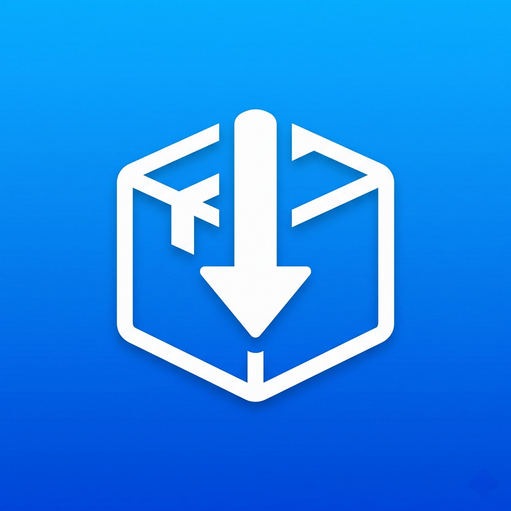

# IPA Downloader

<p align="center">
  
</p>

<p align="center">
  <a href="https://github.com/manhchu2904/IPA-Downloader/actions/workflows/release-build.yml"></a>
  <a href="https://github.com/manhchu2904/IPA-Downloader/actions/workflows/nightly-build.yml"></a>
  <a href="https://github.com/manhchu2904/IPA-Downloader/releases"></a>
  
  <a href="LICENSE"></a>
</p>

<p align="center">
  <b>Tiếng Việt</b> | <a href="README_EN.md">English</a>
</p>

Ứng dụng iOS thuần (SwiftUI) cho phép tìm kiếm, tra cứu lịch sử phiên bản cũ, tải file `.ipa` trực tiếp từ máy chủ App Store và **cài đặt trực tiếp (OTA)** lên iPhone/iPad mà không cần thông qua máy tính.

Dự án nhúng trực tiếp lõi Go của [`majd/ipatool`](https://github.com/majd/ipatool) vào iOS qua `gomobile` (`Ipatoolbridge.xcframework`), kết hợp cùng **Unicorn Engine 2.1.4** (đã vá cơ chế **Split-W^X Dual-Mapped JIT** tương thích từ iOS 15 đến iOS 26+) để xử lý chữ ký số FairPlay SAP ngay trên thiết bị.

---

## Điểm nổi bật

- **Trực tiếp & Bảo mật**: Thiết bị giao tiếp thẳng với máy chủ Apple (iTunes API & App Store CDN). Thông tin đăng nhập và phiên Token của Apple ID được lưu cục bộ trong Keychain trên máy, kèm cơ chế tự động gia hạn phiên (`passwordToken`) khi hết hạn.
- **Tải phiên bản cũ tức thì (Instant Version History)**: Tra cứu nhanh danh sách các bản build trước đây kèm số phiên bản hiển thị trực quan (ví dụ `v1.2.3`) mà không cần kích hoạt JIT khi xem danh sách.
- **Đa tài khoản & Phân loại IPA theo Apple ID**:
  - Đăng nhập nhiều Apple ID cùng lúc (hỗ trợ xác thực 2 yếu tố 2FA), chuyển đổi Storefront nhanh chóng (Việt Nam, Mỹ, Nhật, Hàn,...).
  - Các gói `.ipa` tải về được tự động phân loại vào thư mục riêng của từng tài khoản (`Documents/IPAs/<Apple_ID>/`), giúp tránh nhầm lẫn bản quyền FairPlay khi cài đặt.
- **Cài đặt trực tiếp lên máy (On-Device OTA Installer)**:
  - Cài đặt thẳng file `.ipa` từ trong ứng dụng qua giao thức `itms-services://` với 2 chế độ tuỳ chọn tại mục **Tài khoản**:
    1. **Trực tiếp (Không cần chứng chỉ CA)**: Gửi chỉ thông tin metadata tối thiểu (`Bundle ID`, `Tên app`, `Phiên bản`, `Cổng localhost`) để tạo manifest HTTPS hợp lệ, trong khi gói `.ipa` được truyền 100% nội bộ từ `http://127.0.0.1:<port>/payload.ipa` (không tốn băng thông mạng, không tải file lên mạng).
    2. **Local HTTPS (100% Offline)**: Tự sinh chứng chỉ Root CA nội bộ (`127.0.0.1`) ngay trên thiết bị, hoàn toàn không cần kết nối Internet khi cài đặt.
- **Tải nền không bị ngắt (Background Download Keep-Alive)**: Giữ tiến trình tải luôn hoạt động ổn định khi chuyển sang ứng dụng khác hoặc khoá màn hình, hiển thị tốc độ mạng thời gian thực (`MB/s`) và gửi thông báo khi hoàn tất.
- **Hỗ trợ JIT đa thế hệ (iOS 15 – iOS 26+)**: Tích hợp chuỗi cấp phát JIT 3 tầng tự động chuyển đổi (`Split-W^X vm_remap` cho iOS 26 / StikDebug, `MAP_JIT` cho TrollStore, và `Classic mprotect` cho iOS 15–18).

---

## Cấu trúc thư mục

```text
.
├── Core/
│   ├── go.mod                              # Module Go phụ thuộc majd/ipatool/v2
│   └── ipatoolbridge/
│       ├── bridge.go                       # Cầu nối Go <-> Swift (Auth, Search, Version, Download)
│       └── installer.go                    # Máy chủ Local HTTP/HTTPS cài đặt OTA (itms-services)
├── iOS/
│   ├── project.yml                         # Cấu hình dự án cho XcodeGen (iOS 15.0+, arm64)
│   └── DLiPA2/                             # Mã nguồn giao diện SwiftUI
├── scripts/
│   ├── build-xcframework.sh                # Script biên dịch libunicorn.a và Ipatoolbridge.xcframework
│   └── patches/unicorn-ios.patch           # Bản vá Split-W^X Dual-Mapping & JIT cho Unicorn 2.1.4
└── .github/workflows/
    ├── release-build.yml                   # Workflow đóng gói bản Release chính thức theo Git Tag (v*)
    ├── nightly-build.yml                   # Workflow đóng gói bản Nightly tự động từ nhánh main
    └── cleanup-workflows.yml               # Workflow tự động dọn dẹp lịch sử các workflow cũ/lỗi
```

---

## Cài đặt & Lưu ý khi sử dụng

- **Yêu cầu hệ điều hành**: iOS / iPadOS 15.0 trở lên (hỗ trợ tốt trên cả iOS 26+).
- **Khuyên dùng TrollStore (iOS 15.0 – 17.0)**: Ứng dụng chạy mượt mà nhất trên TrollStore vì được cấp sẵn quyền thực thi mã động (JIT) và cài đặt vĩnh viễn.
- **Lưu ý về JIT (khi dùng SideStore / AltStore / Sideloadly / StikDebug)**:
  - Apple yêu cầu thuật toán ký FairPlay SAP khi **đăng nhập tài khoản lần đầu** hoặc khi phiên đăng nhập hết hạn cần làm mới. Ở bước này, bạn cần bật JIT cho ứng dụng (qua StikDebug, SideStore hoặc AltStore).
  - Sau khi đã đăng nhập thành công, các thao tác **Tìm kiếm ứng dụng**, **Xem lịch sử phiên bản**, **Tải xuống `.ipa`** và **Cài đặt trực tiếp (OTA)** đều **không cần bật JIT**.

---

## Hệ thống CI/CD & Cách build file IPA

Repository được chia thành 2 workflow GitHub Actions riêng biệt:

### 1. `Release Build` (`.github/workflows/release-build.yml`)
- **Kích hoạt**: Tự động chạy khi đẩy tag phiên bản mới theo định dạng `v*` (ví dụ: `v1.0.0`, `v1.1.0`), hoặc chạy thủ công qua `workflow_dispatch`.
- **Tự động gán phiên bản**: Workflow tự động tách số phiên bản từ tag (ví dụ `v1.0.1` → `1.0.1`), ghi trực tiếp vào `CFBundleShortVersionString` và số build (`CFBundleVersion`) trong `Info.plist` của ứng dụng trước khi biên dịch, sau đó tự động tạo **GitHub Release** đính kèm file `IPADownloader-v<version>.ipa` cùng mã băm `.sha256`.
- **Cách phát hành bản Release mới qua Git tag**:
  ```bash
  git tag v1.0.1
  git push origin v1.0.1
  ```

### 2. `Nightly Build` (`.github/workflows/nightly-build.yml`)
- **Kích hoạt**: Tự động chạy khi có commit code mới trên nhánh `main`, hoặc kích hoạt thủ công trong tab **Actions** (hỗ trợ chọn cấu hình `Release` hoặc `Debug`).
- **Định danh bản dựng**: Tự động gắn hậu tố `-nightly.<short_sha>` vào phiên bản ứng dụng (hiển thị trực tiếp ở mục **Tài khoản → Thông tin & Mã nguồn** trong app) và tải gói `.ipa` lên mục **Artifacts** của workflow.

### 3. `Cleanup Workflow Runs` (`.github/workflows/cleanup-workflows.yml`)
- **Dọn dẹp lịch sử Actions**: Tự động xoá toàn bộ lịch sử chạy của các workflow cũ đã bị xoá khỏi repo (ví dụ `build-ios.yml`), xoá các lượt build lỗi/huỷ và chỉ giữ lại số lượng bản build mới nhất (mặc định giữ 3 bản gần nhất cho mỗi workflow). Có thể bấm chạy thủ công bất cứ lúc nào trong tab **Actions**.

### 4. Tự build thủ công trên máy Mac
**Yêu cầu**: macOS có sẵn Xcode 16+, Go 1.26+, `cmake`, `xcodegen`.

```bash
# 1. Cài đặt công cụ cần thiết
brew install cmake xcodegen
go install golang.org/x/mobile/cmd/gomobile@latest
go install golang.org/x/mobile/cmd/gobind@latest
gomobile init

# 2. Biên dịch libunicorn.a, Ipatoolbridge.xcframework và khởi tạo Xcode project
chmod +x scripts/build-xcframework.sh
./scripts/build-xcframework.sh
cd iOS && xcodegen generate

# 3. Mở dự án trong Xcode
open DLiPA2.xcodeproj
```

---

## Lời cảm ơn

Dự án được phát triển dựa trên nền tảng của:

- **[majd/ipatool](https://github.com/majd/ipatool)** bởi **[Majd Alfhaily](https://github.com/majd)**: Công cụ CLI mã nguồn mở tuyệt vời cung cấp lõi giao tiếp với App Store API, xử lý xác thực và tải xuống gói IPA.
- **[Unicorn Engine](https://www.unicorn-engine.org/)**: Trình giả lập CPU đa nền tảng dùng để thực thi quá trình ký số FairPlay SAP.

---

## Giấy phép

Dự án được phân phối dưới giấy phép [MIT](LICENSE).

---

## Miễn trừ trách nhiệm

- Dự án này được phát triển hoàn toàn vì mục đích **học tập, nghiên cứu kỹ thuật và quản lý/sao lưu ứng dụng cá nhân**.
- Ứng dụng không liên kết, không được tài trợ hoặc xác nhận bởi Apple Inc.
- Tác giả không chịu trách nhiệm đối với bất kỳ hành vi lạm dụng, vi phạm Điều khoản Dịch vụ của Apple (Apple Media Services Terms and Conditions) hoặc phân phối lại các ứng dụng có bản quyền trái phép.
