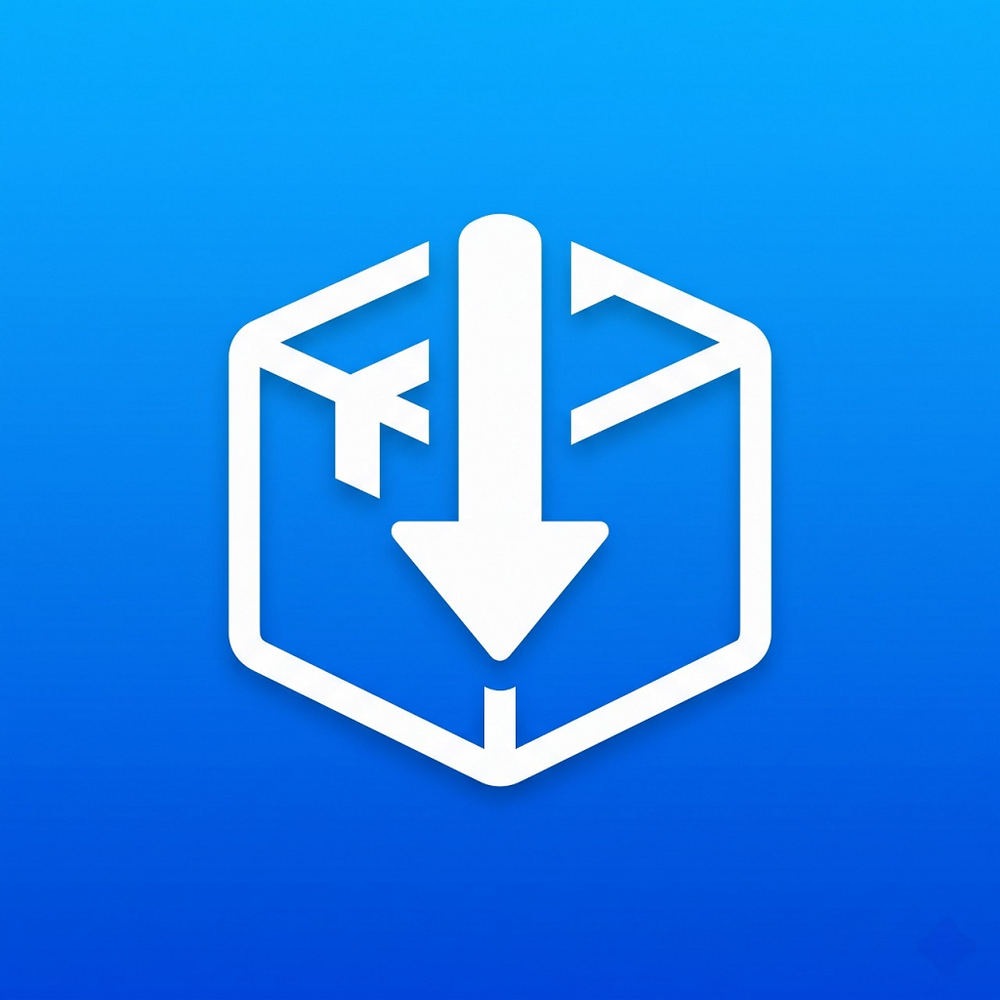

# IPA Downloader

<p align="center">
  
</p>

<p align="center">
  <a href="https://github.com/manhchu2904/IPA-Downloader/actions/workflows/release-build.yml"></a>
  <a href="https://github.com/manhchu2904/IPA-Downloader/actions/workflows/nightly-build.yml"></a>
  <a href="https://github.com/manhchu2904/IPA-Downloader/releases"></a>
  
  <a href="LICENSE"></a>
</p>

<p align="center">
  <a href="README.md">Tiếng Việt</a> | <b>English</b>
</p>

A native SwiftUI iOS app for searching the App Store, browsing previous app versions, downloading `.ipa` files directly from Apple, and installing them on-device without a computer.

Built on top of [`majd/ipatool`](https://github.com/majd/ipatool) via `gomobile` alongside **Unicorn Engine 2.1.4** for on-device FairPlay SAP signing.

---

## Features

- **Direct Apple Connection**: Communicates straight with Apple's servers. Credentials and session tokens are stored locally on the device and refreshed automatically when needed.
- **Version History & Downgrade**: Browse older builds with resolved version numbers (e.g. `v1.2.3`) or enter an External Version ID manually.
- **Multi-Account Support**:
  - Sign in with multiple Apple IDs (with 2FA support) and switch App Store storefronts on the fly.
  - Downloaded `.ipa` files are organized into separate folders per account (`Documents/IPAs/<Apple_ID>/`) to keep licenses clear.
- **On-Device OTA Installer**:
  - Install downloaded `.ipa` packages directly via `itms-services://`, with two modes configurable in the **Accounts** tab:
    1. **Direct Mode (Recommended)**: No certificate setup required. Sends only basic metadata (`Bundle ID`, app name, version, local port) to generate an HTTPS manifest while streaming the `.ipa` locally from `http://127.0.0.1:<port>/payload.ipa`.
    2. **Local HTTPS Mode (Experimental)**: Generates an on-device RSA-2048 Root CA to serve both the manifest and `.ipa` over local HTTPS (requires installing and trusting the CA profile under *Settings → General → About → Certificate Trust Settings*).
- **Background Downloads**: Keeps downloads active when switching apps or locking the screen, showing real-time speed and notifying upon completion.

---

## Requirements & Notes

- **OS**: iOS / iPadOS 15.0 or later.
- **TrollStore**: Works out of the box with built-in JIT access and permanent installation.
- **SideStore / AltStore / StikDebug**: JIT needs to be enabled (via StikDebug, SideStore, or AltStore) when using the app, as signing in, acquiring licenses, and downloading `.ipa` files from Apple require FairPlay SAP signing.

---

## Project Structure

```text
.
├── Core/
│   ├── go.mod                        # Go module depending on majd/ipatool/v2
│   └── ipatoolbridge/
│       ├── bridge.go                 # Go-to-Swift bridge
│       └── installer.go              # Local OTA installer server
├── iOS/
│   ├── project.yml                   # XcodeGen configuration
│   └── DLiPA2/                       # SwiftUI source code
└── scripts/
    ├── build-xcframework.sh          # Builds libunicorn.a & Ipatoolbridge.xcframework
    └── patches/unicorn-ios.patch     # Unicorn 2.1.4 iOS arm64 patch
```

---

## Credits

- **[majd/ipatool](https://github.com/majd/ipatool)** by [Majd Alfhaily](https://github.com/majd) — core App Store API and IPA download engine.
- **[Unicorn Engine](https://www.unicorn-engine.org/)** — CPU emulator used for FairPlay SAP signing.

---

## License

Released under the [MIT License](LICENSE).

## Disclaimer

This project is intended for educational use and personal app backups. It is not affiliated with Apple Inc.; users are responsible for how they use it.
